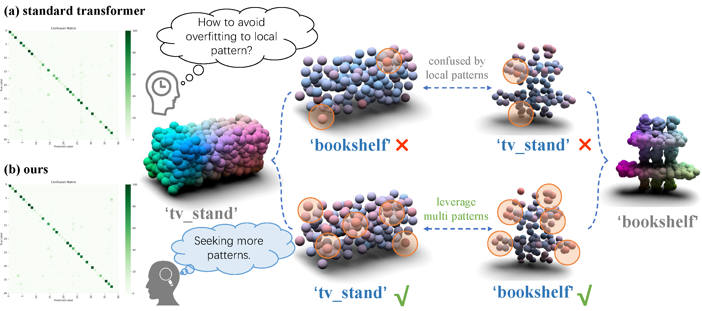

# APCT: Adversarial Point Cloud Transformer Towards Recognition Against Real-world Corruptions [NeurIPS 2024]
Official implementation of [APCT: Adversarial Point Cloud Transformer Towards Recognition Against Real-world Corruptions](https://arxiv.org/abs/2411.00462).

The paper has been accepted by **NeurIPS 2024**.


## News
* **[2024.12.11]** The code has been released.

## Introduction
Achieving robust 3D perception in the face of corrupted data presents a challenging hurdle within 3D vision research. Contemporary transformer-based point cloud recognition models, albeit advanced, tend to overfit to specific patterns, consequently undermining their robustness against corruption. In this work, we introduce the Target-Guided Adversarial Point Cloud Transformer, termed APCT, a novel architecture designed to augment global structure capture through an adversarial feature erasing mechanism predicated on patterns discerned at each step during training. Specifically, APCT integrates an Adversarial Significance Identifier and a Target-guided Promptor. The Adversarial Significance Identifier, is tasked with discerning token significance by integrating global contextual analysis, utilizing a structural salience index algorithm alongside an auxiliary supervisory mechanism. The Target-guided Promptor, is responsible for accentuating the propensity for token discard within the self-attention mechanism, utilizing the value derived above, consequently directing the model attention towards alternative segments in subsequent stages. By iteratively applying this strategy in multiple steps during training, the network progressively identifies and integrates an expanded array of object-associated patterns. Extensive experiments demonstrate that our method achieves state-of-the-art results on multiple corruption benchmarks.

<div align="center">
  
</div>

## Requirements

### Install 
```
# Create a new conda environment
conda create -n apct python=3.8 -y

# install CUDA 11.3 torch 1.12
pip install torch==1.12.1+cu113 torchvision==0.13.1+cu113 torchaudio==0.12.1 --extra-index-url https://download.pytorch.org/whl/cu113

# install requirements
pip install -r requirements.txt

# Chamfer Distance & emd
cd openpcmae/cpp/chamfer_dist
python setup.py install --user
cd ../emd
python setup.py install --user
# PointNet++
# pip install "git+https://github.com/erikwijmans/Pointnet2_PyTorch.git#egg=pointnet2_ops&subdirectory=pointnet2_ops_lib"
cd ../pointnet2_ops_lib
python setup.py install

# GPU kNN
# pip install --upgrade https://github.com/unlimblue/KNN_CUDA/releases/download/0.2/KNN_CUDA-0.2-py3-none-any.whl
cd ..
pip install KNN_CUDA-0.2-py3-none-any.whl
cd ../..
```

### Dataset

The overall directory structure should be:
```
│APCT/
├──cfgs/
├──data/
│   ├──ModelNet40Ply2048/
│   ├──ModelNet_C/
│   ├──ScanObjectNN/
│   ├──ScanObjectNN_C/
├──datasets/
├──.......
```

#### ModelNet40Ply2048
Note in this experiment, we do not use any re-sampled version of ModelNet40 (more than 2K points) or any normal information. The data we use is: [modelnet40_ply_hdf5_2048]

Download [ModelNet40Ply2048](https://shapenet.cs.stanford.edu/media/modelnet40_ply_hdf5_2048.zip) and unzip the folder under ```./data/ModelNet40Ply2048```.
You can also download the data via this [link]( (https://github.com/ma-xu/pointMLP-pytorch/releases/download/Modenet40_dataset/modelnet40_ply_hdf5_2048.zip)).
The directory structure should be:
```
|data/
|--- ...
|--- ModelNet40Ply2048
    |--- modelnet40_ply_hdf5_2048
        |--- ply_data_train0.h5
        |--- ply_data_train1.h5
        |--- ...
```

#### ModelNet-C
Download [ModelNet-C](https://drive.google.com/file/d/1KE6MmXMtfu_mgxg4qLPdEwVD5As8B0rm/view?usp=sharing) dataset and unzip the folder under `./data/ModelNet_C`. The directory structure should be:
```
│data/
|--- ...
|--- ModelNet_C/
    |--- modelnet_c/
        |--- scale_0.h5
        |--- ...
        |--- scale_4.h5
```


#### ScanObjectNN
Download [ScanObjectNN](https://drive.google.com/uc?id=1iM3mhMJ_N0x5pytcP831l3ZFwbLmbwzi) (hardest) and unzip the folder under ```./data/ScanObjectNN```.
The directory structure should be:
```
|data/
|--- ...
|--- ScanObjectNN
    |--- main_split
        |--- training_objectdataset_augmentedrot_scale75.h5
        |--- test_objectdataset_augmentedrot_scale75.h5
```
#### ScanObjectNN-C
Download [ScanObjectNN-C](https://drive.google.com/drive/folders/1CD_jOlXUqx_out7xoph_Ymz7EaHgElLW?usp=sharing) dataset and unzip the folder under `./data/ScanObjectNN_C`. The directory structure should be:
```
│data/
|--- ...
|--- ScanObjectNN_C/
    |--- scanobjectnn_c/
        |--- scale_0.h5
        |--- ...
        |--- scale_4.h5
```
## Get Started
### ModelNet-C
```
CUDA_VISIBLE_DEVICES=0 python main.py --config cfgs/end2endtrain/modelnet40ply/APCT_mapping1.yaml
```

### ScanObjectNN-C
```
CUDA_VISIBLE_DEVICES=0 python main.py --config cfgs/end2endtrain/scanhardest/APCT_mapping1.yaml
```

## Acknowlegment
This repo benefits from [Point-MAE](https://github.com/Pang-Yatian/Point-MAE), [ModelNet-C](https://github.com/jiawei-ren/ModelNet-C), [PointCloud-C](https://github.com/ldkong1205/PointCloud-C), and [AdaptPoint](https://github.com/Roywangj/AdaptPoint). Thanks for their wonderful works. 


## Citation
```
@article{wang2024target,
  title={Target-Guided Adversarial Point Cloud Transformer Towards Recognition Against Real-world Corruptions},
  author={Wang, Jie and Xu, Tingfa and Ding, Lihe and Li, Jianan},
  journal={arXiv preprint arXiv:2411.00462},
  year={2024}
}
```

## Contact
If you have any question about this project, please feel free to contact jwang991020@gmail.com.